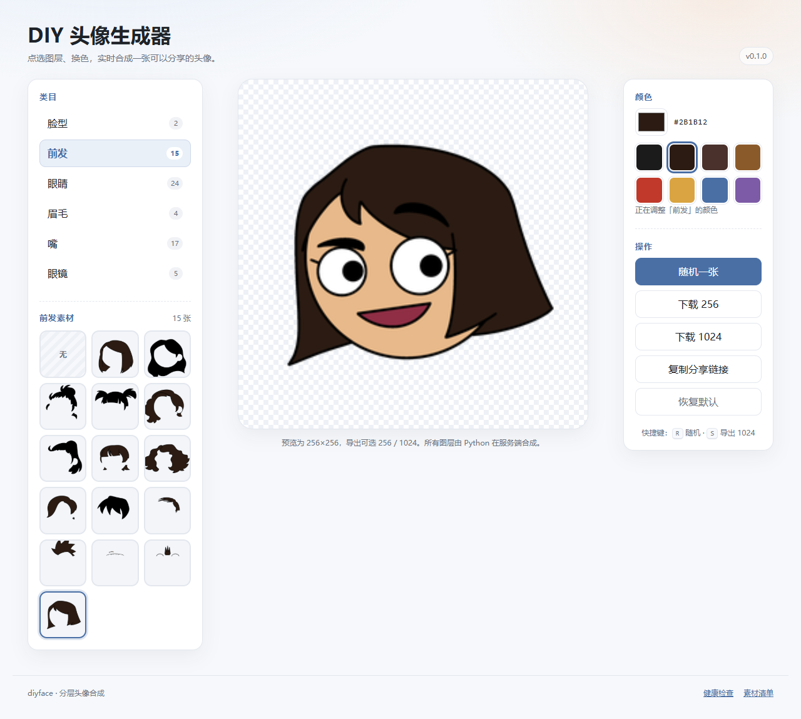
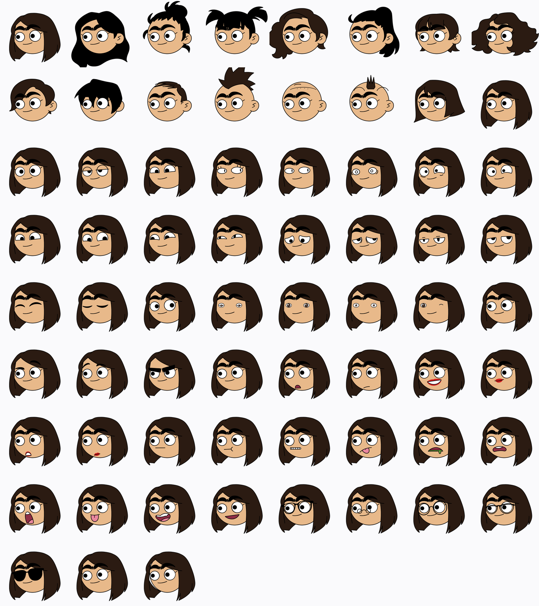

# diyface · 虚拟头像设计系统

用 Python 把「分层素材 + 参数化合成」做成 Web 服务：浏览器点选素材，服务端用 Pillow
按 z 序把脸型、服装、前发/后发、五官、眼镜、帽子叠成头像，支持 256 与 1024 两种尺寸导出；
用户只持有一份可复现的「配方（Recipe）」，能存库、能分享、能二次编辑。

**当前进度**：捏脸路径闭环（点选、实时预览、换色、随机、导出、分享）已完成，
契约已按《虚拟头像设计系统 · 项目说明与分工》v1.0 迁移到 **10 槽位 / Flask / 80KB**。
照片路径（`/api/analyze`）与作品存储（`/api/works`）由 P4/P5 负责，尚未实现。

## 三步跑起来

```powershell
python -m venv .venv
.venv\Scripts\Activate.ps1
pip install -e ".[dev]"
python -m flask --app diyface.app run --debug --port 8000
```

打开 <http://127.0.0.1:8000> 。macOS 把激活那行换成 `source .venv/bin/activate`。

## 界面



- 左侧按清单生成类目与素材格，点素材立即更新预览，点「无」清空该图层。
- 中间是 1:1 预览；请求去抖 120ms、带序号防止旧响应闪回。
- 右侧取色（预设色来自清单，不硬编码）、随机、下载 256/1024、复制分享链接。
- 配方自动写入 `localStorage`；分享链接形如 `/?r=<base64url>`，打开即复现同一张脸。
- 窄屏自动收成单列：预览置顶，类目横向滑动，所有按钮至少 44px。

素材总览（67 张，逐个贴脸验证过对齐）：



## 跑测试

```powershell
python -m pytest
```

clone 之后建议执行一次，让每次提交自动跑测试：

```powershell
git config core.hooksPath .githooks
```

素材相关的三条命令：

```powershell
python -m diyface verify                # 校验尺寸、模式、透明度、命名、体积、tint 蒙版
python -m diyface build-thumbs          # 生成 256 缩略图
python scripts/import_pack.py --src <目录> --dry-run   # 导入外部素材前先预演
```

## 代码托管

主力仓库在 Gitee（公开，6 人协作不受私有仓库人数限制），GitHub 保留为备份镜像：

```powershell
git clone https://gitee.com/chords-of-fate/diyface.git
```

## 现有接口

| 方法 | 路径 | 说明 |
| --- | --- | --- |
| GET | `/` | 三栏交互首页，内联素材清单 |
| GET | `/api/manifest` | 素材清单与默认配方 |
| GET | `/api/recipe/default` | 默认配方 |
| POST | `/api/render` | 按配方返回 PNG，带 `ETag` 与 304 缓存 |
| POST | `/api/random` | 返回合法随机配方，可带 `seed` |
| GET | `/healthz` | 版本、槽位数与素材数，部署探针用 |
| GET | `/assets/<目录>/<文件>` | 素材原图与缩略图，前端直接当图片用 |

错误统一为 `{"error": {"code", "message", "field"}}`，`code` 目前有
`BAD_SIZE`、`UNKNOWN_ASSET`、`INVALID_REQUEST`。

## 槽位与素材

| z | 槽位 | 可着色 | 目标数量 |
| --- | --- | --- | --- |
| 10 | skin 脸型 | 是 | 2 |
| 20 | clothes 服装 | 是 | 6 |
| 25 | hair_back 后发 | 是 | 6 |
| 30 | hair 前发 | 是 | 8 |
| 40 | eyes 眼睛 | 是 | 8 |
| 45 | brows 眉毛 | 是 | 4 |
| 50 | mouth 嘴 | 是 | 7 |
| 60 | glasses 眼镜 | 否 | 5 |
| 70 | hat 帽子 | 是 | 5 |
| 80 | extra 配饰 | 否 | 3 |
| — | 合计 | — | **54（已交付）** |

画布 1024×1024、RGBA、单张不超过 80KB；对齐基线：头顶 y=170、眼睛 y=460、脸中心 y=500、嘴 y=620、肩线 y=880。

## 目录

```
src/diyface/            应用代码（app.py 路由、models.py 槽位与配方、render.py 合成）
src/diyface/templates/  Jinja2 模板（三栏首页）
src/diyface/static/     样式与脚本（app.js、style.css）
assets/                 分层素材（10 个槽位目录，_thumb/ 放缩略图）
tests/                  测试（391 passed, 11 skipped）
docs/                   计划书、协作指南、任务说明、迁移说明
```

## 文档

- [部署：让别人打开网址就能用](docs/DEPLOY.md)
- [可选 OCR：图纸截图自动认色号](docs/OCR.md)
- [契约迁移说明 v2](docs/MIGRATION-v2.md)（10 槽位 / Flask / 80KB，必读）
- [实施计划书](docs/PLAN.md)
- [新人上手与分工执行方案](docs/ONBOARDING.md)
- [第 1 周任务清单（手把手）](docs/WEEK-01.md)
- [换美术风格：Figma 导出与导入](docs/ASSET-IMPORT.md)
- [每周任务清单（D1–D7）](docs/WEEK-01.md)
- [给 DSH 的项目交接简报](docs/AGENT-BRIEF.md)
- [协作与 Gitee 托管指南](docs/COLLABORATION.md)
- [实验任务书](docs/DIY头像生成器-实验任务书.docx)

## 素材来源

- 角色素材：[Adventurer](https://www.dicebear.com/styles/adventurer/) by Lisa Wischofsky，
  经 [DiceBear](https://www.dicebear.com/) 提供，[CC BY 4.0](https://creativecommons.org/licenses/by/4.0/)。
  本项目对其做了裁切、重新分层与白底化处理。
